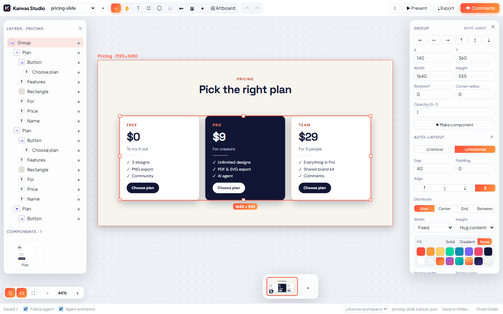

<p align="center">
  
</p>

<p align="center">
  <b>A free, local design engine driven by AI agents over MCP.</b><br>
  Pitch decks, posters, logos, and social graphics — watch your agent draw step by step, and jump in to edit anything yourself.
</p>

<p align="center">
  <a href="#use-inside-hermes-desktop">Hermes Desktop</a> ·
  <a href="#use-locally-without-hermes-mcp">Claude Code</a> ·
  <a href="#use-locally-without-hermes-mcp">Codex</a> ·
  <a href="#use-locally-without-hermes-mcp">Cursor</a> ·
  <a href="https://modelcontextprotocol.io">Any MCP Agent</a> ·
  <a href="LICENSE">MIT License</a>
</p>

---

## See it in action

### Home screen & ready-made templates
Write a brief for your agent, resume recent work, or start from one of 6 built-in templates (startup pitch deck, A4 event poster, Instagram 4:5 promo, 9:16 story, YouTube thumbnail, pricing slide).

<p align="center">
  
</p>

### Live multi-artboard canvas, layers & Figma-style components
Every agent edit appears live with a moving cursor, work frame, and artboard scan. Reusable **components** keep repeated cards, stats, and buttons in sync while allowing per-copy overrides.

<p align="center">
  
</p>

### Full visual editor with auto-layout, Google Fonts & 2,100+ icons
Jump into the canvas whenever you like — edit typography (any Google Font), solid/gradient fills, Figma-style auto-layout frames, vector paths (Pen tool), and Lucide icons directly.

<p align="center">
  
</p>

### Pin comments & send feedback back to your agent
Press **C**, click any spot on an artboard, leave a note, and click **Send to agent**. Your agent reads exact element IDs and coordinates via `kanvas_comments`, applies the edits, and resolves each pin with a reply.

<p align="center">
  
</p>

---

## Key features

- **Live agent choreography** — watch the agent cursor and work frame move to each element as it builds your design. No black box.
- **Visual self-check for agents** — `kanvas_view` renders PNGs using the exact same engine as the canvas and reports automatic **ISSUES** (overlapping text, card/artboard overflow, low contrast, missing images) and **SUGGESTIONS**.
- **Real vectors & Pen tool** — SVG `path` elements for logos, curves, arrows, and shapes; click for corner points, drag for Bezier curves, double-click any vector to edit points.
- **Groups + Auto-Layout** — Figma-style horizontal/vertical stacks (`baris`/`kolom`), gap, padding, hug (`peluk`), and fill (`isi`).
- **Components** — edit a main component once and every copy updates automatically while preserving text, color, and icon overrides.
- **2,100+ icons & every Google Font** — bundled Lucide icon library plus automatic loading of any Google Font by name.
- **Comments** — pin notes on any spot or element and hand them to your agent in one click.
- **One-click export** — PNG / JPG (`1×–4×`), editable SVG, multi-page PDF (full deck or single artboard), clipboard PNG, or `.kanvas.json` + images.
- **100% local & free** — no account, no cloud upload, no telemetry.

---

## Requirements

- **Node.js 18+**
- **Google Chrome or Microsoft Edge** (used locally in headless mode for PNG/PDF rendering via `kanvas_view`, `kanvas_export`, and `kanvas render`)

---

## Use inside Hermes Desktop

Kanvas Studio ships as a **Portable Agent Plugin (`plugin.json` + `mcp.json` + `skills/` + `desktop/plugin.js`)**, so Hermes automatically wires up the **Desktop canvas tab**, the **13 `kanvas_*` MCP tools**, and the **`kanvas-studio` skill** on Windows, macOS, and Linux.

### Install from Hermes CLI or Desktop

```bash
# From the Hermes plugin catalog (once listed):
hermes plugins install kanvas-studio

# Or install directly from GitHub:
hermes plugins install https://github.com/ranggaoscar/kanvas-studio
```

Then enable **Kanvas Studio** under **Capabilities → Plugins** and restart Hermes so the bundled `kanvas` MCP server starts.

- Open the canvas from **Kanvas Studio** in the sidebar, the **Kanvas** button in the status bar, the command palette, or **Ctrl+Shift+K**.
- Closing the tab never disables the plugin — and as soon as your agent calls a Kanvas tool, the canvas tab opens automatically.
- Designs live in Hermes's plugin data folder (`plugin-files/data/kanvas-studio`), shared automatically between the Desktop tab and the MCP server.

<details>
<summary>Local development install on Windows (without Hermes plugin installer)</summary>

```powershell
git clone https://github.com/ranggaoscar/kanvas-studio
cd kanvas-studio
powershell -ExecutionPolicy Bypass -File .\install.ps1
```

Then reload plugins in Hermes Desktop (`Ctrl+K` → **Reload desktop plugins**).

</details>

---

## Use locally without Hermes (MCP)

Use Kanvas Studio standalone with **Claude Code**, **Codex**, **Cursor**, or any MCP client. The MCP server starts the local studio automatically and opens it in your browser so you can watch live.

### 1. Clone once (works on all Node/npm versions, including npm 12+)

```bash
git clone https://github.com/ranggaoscar/kanvas-studio
cd kanvas-studio

# Open the studio manually in your browser (http://127.0.0.1:4848):
node bin/kanvas.js

# Or render & lint a design file from the terminal:
node bin/kanvas.js render design.kanvas.json
```

> **Note for `npx` users:** If you run `npx -y github:ranggaoscar/kanvas-studio mcp`, npm 12+ (Node 24+) blocks Git URLs by default (`EALLOWGIT`) unless you pass `--allow-git=root` or use a local clone path (`node /path/to/kanvas-studio/bin/kanvas.js mcp`).

### 2. Connect your AI agent

**Claude Code**

```bash
claude mcp add kanvas -- node /absolute/path/to/kanvas-studio/bin/kanvas.js mcp
```

**Codex** (`~/.codex/config.toml`)

```toml
[mcp_servers.kanvas]
command = "node"
args = ["/absolute/path/to/kanvas-studio/bin/kanvas.js", "mcp"]
```

**Cursor / Windsurf / any stdio MCP client**

```json
{
  "mcpServers": {
    "kanvas": {
      "command": "node",
      "args": ["/absolute/path/to/kanvas-studio/bin/kanvas.js", "mcp"]
    }
  }
}
```

**Hermes manual `config.yaml` (if not using the bundled plugin)**

```yaml
mcp_servers:
  kanvas:
    command: node
    args: ["/absolute/path/to/kanvas-studio/bin/kanvas.js", "mcp"]
    timeout: 180
    env:
      KANVAS_NO_OPEN: "1"   # watch inside the Hermes Desktop canvas instead of a browser
```

Then ask your agent:

> *"Create a 5-slide pitch deck for a developer analytics startup — modern dark cover, 3 feature cards, and a traction slide."*

The studio opens at `http://127.0.0.1:4848` (designs are saved in `~/KanvasStudio` by default, configurable via `KANVAS_HOME`).

---

## Agent MCP tools

| Tool | What it does |
|---|---|
| `kanvas_guide` | Format reference, element types, edit ops, typography scale, and layout recipes |
| `kanvas_status` | Active workspace, open design, user's current selection (`terpilih`), open comments, and design list |
| `kanvas_templates` | List built-in templates (`pitch-deck`, `poster-acara`, `ig-promo`, `ig-story`, `yt-thumbnail`, `harga`) |
| `kanvas_create` | Create a new design from a preset (`slide`, `a4`, `ig-feed`, `ig-story`, `yt-thumbnail`, `logo`, …), custom size, or template |
| `kanvas_read` | Read a design document as JSON |
| `kanvas_edit` | Atomic edit operations: add / update / delete / reorder / group / ungroup / make component / detach |
| `kanvas_view` | Render PNGs of artboards + automatic design checker (**ISSUES** and **SUGGESTIONS**) |
| `kanvas_export` | Export to any folder as `png`, `jpg`, `svg`, `pdf`, or `kanvas` (editable `.kanvas.json` + local images) |
| `kanvas_icons` | Search 2,100+ bundled Lucide line icons |
| `kanvas_import_image` | Copy a local image (`png`/`jpg`/`webp`/`svg`/`gif`) into the workspace `gambar/` folder |
| `kanvas_comments` | Read comments pinned by the user (artboard, position, target element) |
| `kanvas_resolve_comment` | Mark comment(s) resolved with a short reply shown on the pin |
| `kanvas_open` | Open the studio UI in the default browser |

Full document & operation spec: [docs/FORMAT.md](docs/FORMAT.md).

---

## Edit on the canvas yourself

| Action | Shortcut / How |
|---|---|
| Tools | `V` Select · `H` / `Space` Pan · `T` Text · `R` Rectangle · `O` Ellipse · `P` Pen · `I` Icons · `C` Comment |
| Pen tool | Click = corner point · Drag = Bezier curve · Click first point = close · `Enter`/`Esc` = finish · Double-click vector = edit points (`Alt` breaks handles, `Delete` removes point) |
| Groups & components | `Ctrl+G` Group · `Ctrl+Shift+G` Ungroup · `Ctrl+Alt+K` Make component · Click = group, click again = child, `Ctrl+Click` = direct select |
| Zoom & view | `Ctrl+Scroll` Zoom · `Shift+1` Fit all · `Shift+2` Fit active artboard · `Ctrl+.` Focus mode |
| Edit | Drag with smart guides (`Alt` disables snap) · `Shift` locks aspect ratio · Double-click text to edit · `Ctrl+D`, `Ctrl+C`/`V`, `Delete`, arrow keys |
| Comments | Press `C` → click a spot → post note → open **Comments** in the toolbar → **Send to agent** |

---

## Privacy, security & disclosures

- **Local-only server:** The local studio binds strictly to `127.0.0.1`, checks `Host` and `Origin`, and requires the `X-Kanvas: 1` header so third-party websites cannot call the local API.
- **No accounts, no telemetry:** Designs stay on your machine. Nothing is uploaded to any cloud service.
- **Network use:** Only Google Fonts stylesheets/font files are fetched when rendering designs (plus any external `https://` image URL you explicitly add to a design).
- **Local subprocesses:** Headless Chrome or Microsoft Edge is launched on demand only for `kanvas_view`, `kanvas_export` (`png`/`jpg`/`pdf`), and `kanvas render`, with a **minimal environment** (Hermes API keys, `GH_TOKEN`, and other host secrets are never passed to child processes). In headless render mode, external image URLs are restricted to public `https://` hosts (private, loopback, and cloud-metadata addresses are refused).
- **File access:** Studio HTTP APIs are confined strictly to the active workspace folder (`~/KanvasStudio` standalone, or Hermes's `plugin-files/data/kanvas-studio` inside Hermes Desktop). `kanvas_import_image` and `kanvas_export` read/write only paths explicitly requested via MCP.

---

## Repository layout

| Path | Purpose |
|---|---|
| `plugin.json`, `mcp.json` | Portable Agent Plugins v1 manifest + local stdio MCP server declaration for Hermes |
| `desktop/plugin.js` | Canvas UI, renderer (Canvas 2D, SVG, PDF), auto-layout, components, pen tool, and comments — shared by Hermes Desktop **and** the local web app |
| `app/` | Local browser host adapter (`host.js`, `main.js`), headless render entry (`render.html`), visual design linter (`lint.js`), and prebuilt `dist/` assets |
| `server/` | Local studio HTTP server (`studio.js`), MCP stdio server (`mcp.js`), atomic edit ops (`ops.js`, `komponen.js`, `pena.js`), workspace manager (`ruang.js`), and headless renderer (`render.js`) |
| `bin/kanvas.js` | CLI entry point (`kanvas`, `kanvas mcp`, `kanvas render`) |
| `skills/kanvas-studio/` | Agent skill (`SKILL.md`, `kanvas_cek.py`, QA notes) |
| `templates/` | 6 built-in `.kanvas.json` starter templates (generated by `scripts/template.js`) |
| `docs/FORMAT.md` | Full design document & edit operation reference |
| `test/` | Automated test suite (`npm test`) |

> The `.kanvas.json` file format keeps its original Indonesian schema keys (`teks`, `ukuran`, `warna`, `kotak`, `grup`, …) for backward compatibility; all keys are documented in [docs/FORMAT.md](docs/FORMAT.md) and served to agents via `kanvas_guide`.

---

## Development

```bash
npm install                    # dev dependencies only (esbuild, react, lucide-static)
node scripts/template.js       # regenerate templates/*.kanvas.json
npm run build                  # build app/dist/kanvas.js, ikon.json, template.json
npm test                       # run full test suite (ops, components, studio security, MCP, 2,100+ icons)
hermes plugins validate .      # run Hermes catalog admission checks
```

## License

MIT — see [LICENSE](LICENSE). Bundled icons are from [Lucide](https://lucide.dev) (ISC License, © Lucide Icons and Contributors).
