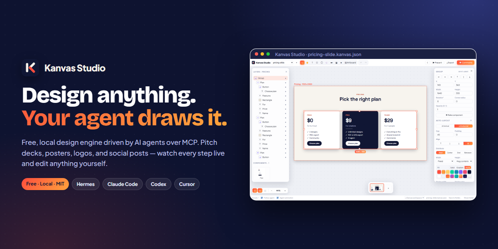
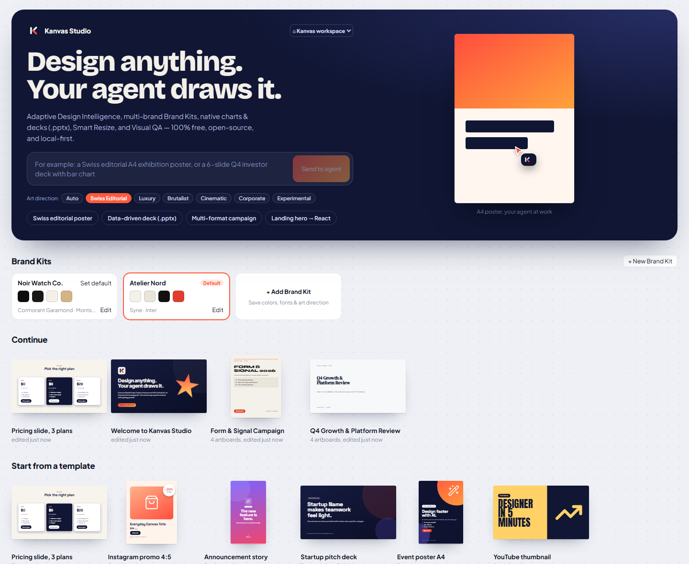
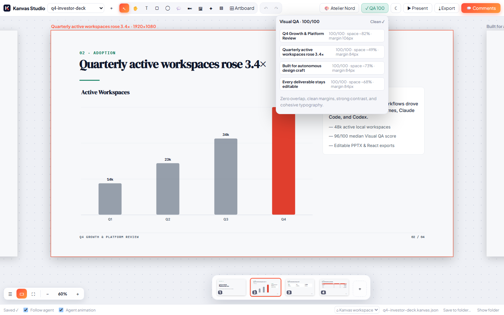
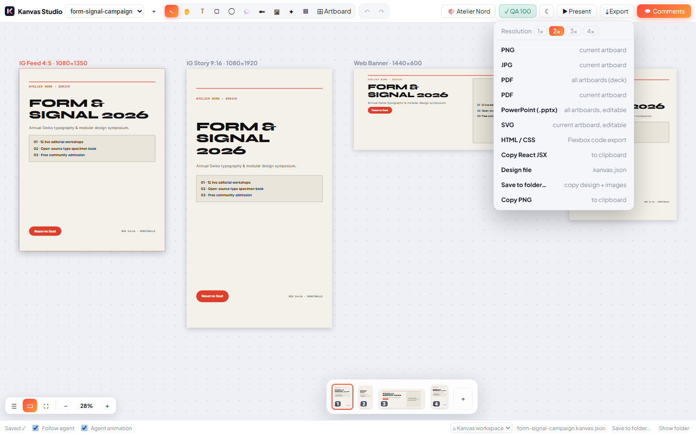
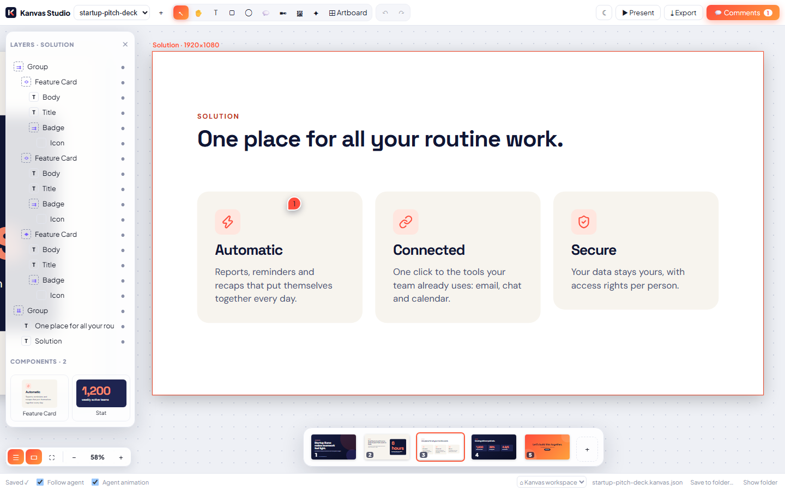
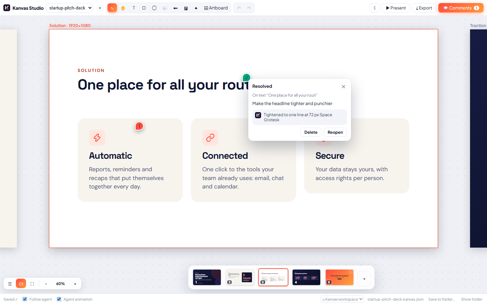

[](https://github.com/sponsors/ranggaoscar)
[](LICENSE)

# Kanvas Studio

**Design anything. Your agent draws it.**
**Free forever. Open source. Local first.**
*Built for AI agents. Designed for everyone. Supported by the community.*

Kanvas Studio is an **agent-native visual design engine** — not just another template editor. AI agents (**Hermes Desktop**, **Claude Code**, **Codex**, **Cursor**, or any MCP client) art-direct, build multi-format campaigns and data-driven presentations, insert editable charts/tables/diagrams, Smart Resize across aspect ratios, run autonomous Visual QA, and export editable **PowerPoint (`.pptx`)**, **HTML/React/Tailwind code**, **PNG/JPG/SVG/PDF**, and **`.kanvas.json`** — all locally while you watch every step on a live canvas and edit anything yourself.

**100% free, MIT open-source, and local-first — zero paywalls, zero subscriptions, zero premium tiers, zero cloud lock-in.** Funded strictly through voluntary community sponsorship and donations.

[Hermes Desktop](#use-inside-hermes-desktop) · [Standalone MCP](#use-locally-without-hermes-mcp) · [Design Intelligence](#design-intelligence) · [MCP Tools (23)](#agent-mcp-tools) · [Roadmap](#roadmap) · [Support Kanvas Studio](#support-kanvas-studio)

---

## See it in action

### Home screen, Art Direction lenses & multi-brand Brand Kits
Pick an aesthetic direction (*Swiss Editorial*, *Luxury*, *Brutalist*, *Cinematic*, *Corporate*, *Experimental*, or *Auto*), manage reusable local **Brand Kits** (colors, fonts, logos, direction), resume recent work, or start from built-in/community templates.



### Data-driven Presentations, native charts & Live Visual QA (`100/100`)
Generate structured multi-slide decks with editable native **Bar, Horizontal Bar, Line, Donut, Table, and Diagram** visuals — verified automatically by the **Visual QA engine** (0–100 score, whitespace, margins, contrast, hierarchy, and font discipline) both in the canvas toolbar and over MCP.



### Multi-format Campaigns, Smart Resize & Export (`.pptx`, `HTML/CSS`, `React`)
Turn one brief + Brand Kit into coordinated **IG Feed, IG Story, Carousel, A4 Poster, Web Banner, and YouTube Thumbnail** artboards, Smart Resize any artboard across aspect ratios, and export editable **PowerPoint (`.pptx`)**, **Flexbox HTML/CSS**, **React JSX**, **PDF**, **SVG**, or **PNG/JPG (`1×–4×`)**.



### Live multi-artboard canvas, layers & Figma-style components
Every agent edit appears live with a moving cursor, work frame, and artboard scan. Reusable **components** keep repeated cards, stats, and buttons in sync while allowing per-copy overrides.



### Full visual editor with auto-layout, Google Fonts & 2,100+ icons
Jump into the canvas whenever you like — edit typography (any Google Font), solid/gradient fills, Figma-style auto-layout frames, vector paths (Pen tool), native charts/tables, and Lucide icons directly.


### Pin comments & send feedback back to your agent
Press **C**, click any spot on an artboard, leave a note, and click **Send to agent**. Your agent reads exact element IDs and coordinates via `kanvas_comments`, applies the edits, and resolves each pin with a reply.



---

## Design Intelligence

Most agent design tools produce repetitive, cookie-cutter slides because their skills hardcode a single gradient and fixed coordinates. Kanvas Studio includes an adaptive **Design Intelligence** engine (`kanvas_art_direction`) so agents choose aesthetics, proportional grids, typography, and composition from the user's actual brief and brand context:

- **7 open reference lenses (freely mixable, extensible via community JSON, never creative limits):**
  - **Swiss Editorial** — modular grids, crisp hairlines, asymmetric typography, paper/ink + 1 decisive signal color
  - **Luxury Minimalism** — refined serif display, tracked uppercase sans, generous 10–14% margins, quiet authority
  - **Neo-Brutalism** — raw monumental display type, thick solid borders, stark geometric blocks, high-voltage tension
  - **Cinematic** — atmospheric full-bleed visuals, dramatic scale contrast, whisper-quiet tracked captions
  - **Corporate Premium** — insight-first executive clarity, oversized tabular KPIs, disciplined structural rules
  - **Experimental** — sculptural vector `path` geometry, intentional diagonal/rotated tension, chromatic surprises
  - **Contemporary Product** — modern neo-grotesque type, varied-weight bento layouts, crisp Lucide line icons
- **Multi-Brand Brand Kit (`kanvas_brand`):** Save unlimited local brand identities (`<workspace>/brands/`) with colors, fonts, logos, reusable visual assets, voice, and guidelines — then weave them directly into art direction or apply them to designs with automatic contrast safety.
- **Autonomous Visual Quality Assurance (`kanvas_view`):** Renders PNGs with the exact same engine as the live canvas and produces a **Visual QA Score (0–100)**, per-artboard metrics (whitespace, margins, font count, type hierarchy ratio), multi-point & worst-case gradient WCAG contrast checks, near-miss alignment detection, overlap/overflow checks, and Brand Kit font consistency checks so agents self-correct before finishing.

---

## Key features

- **P0 — Design Intelligence, Brand Kit & Visual QA:** Adaptive art direction (`kanvas_art_direction`), multi-brand local Brand Kits (`kanvas_brand`), and quantitative Visual QA (`kanvas_view` with QA Score 0–100 and per-artboard metrics).
- **P1 — Marketing Automation & Smart Resize:** Generate coordinated multi-format campaign sets and swipeable carousels from one brief (`kanvas_campaign`), or Smart Resize any artboard across aspect ratios with automatic stack reflow (`kanvas_resize`).
- **P1 — Presentation Engine + Editable `.pptx` Export:** Build non-monotonous research/data-driven decks with speaker notes (`kanvas_presentation`) and export zero-dependency **editable PowerPoint (`.pptx`)** files (`kanvas_export { format: "pptx" }`) with real text boxes, shapes, gradients, vector paths, embedded images, and presenter notes.
- **P1 — Native Data Visualization:** Insert editable `bar`, `hbar`, `line`, `donut`, `table`, and `diagram` primitives (`kanvas_dataviz`) built from standard Kanvas Studio vectors, groups, and text.
- **P2 — Design-to-Code:** Export artboards to clean semantic **HTML/CSS**, **React (JSX + CSS)**, or **Tailwind** markup (`kanvas_to_code`) mapping auto-layout groups to genuine Flexbox.
- **P2 — Reusable Asset Library & Community Ecosystem:** Searchable local asset library (`kanvas_assets`) for images and SVG marks, plus pure-JSON community templates, aesthetic directions, and workflows (`kanvas_community`, [docs/COMMUNITY.md](docs/COMMUNITY.md)).
- **Live visual canvas:** Agent cursor choreography, Pen vector tool, Figma-style auto-layout (`tata`) & reusable components, 2,100+ bundled Lucide icons, any Google Font, canvas comment pins, and one-click export (`PNG`/`JPG` `1×–4×`, `SVG`, multi-page `PDF`, editable `PPTX`, `.kanvas.json`).
- **100% free & local-first:** MIT licensed, zero runtime npm dependencies, zero Python dependencies, no accounts, no paywalls, no telemetry.

---

### New in v0.4.0

- **Chat-first document bridge:** use `kanvas_document` for PDF, XLSX, and CSV files in the workspace. Standalone Home also has one **Impor PDF / Excel** action. XLSX/CSV can become an editable A4 report draft; Hybrid PDF reopens its embedded Kanvas design. External PDF Quick Edit uses a locked raster background and auto-fitted text overlays; it does not reconstruct editable PDF text or run OCR.
- **Smart Presentation:** when the layout is not specified, a structured numerical series can become a chart, steps a diagram, and comparisons a table or KPI callout. Narrative slides keep an editorial layout instead of receiving a chart by default.
- **Faster iteration:** use `kanvas_guide {topic:"quick"}`, `kanvas_read {mode:"summary"}`, `kanvas_view {mode:"fast_qa"}` for estimated checks or `mode:"qa_only"` for browser QA without PNGs. Inspect rendered PNGs before export. `kanvas_edit {auto_heal:true}` is opt-in.

## Requirements

- **Node.js 18+**
- **Google Chrome or Microsoft Edge** (used locally in headless mode for PNG/JPG/PDF rendering and Visual QA via `kanvas_view`, `kanvas_export`, and `kanvas render`; `.pptx` and code export require no browser)

---

- **External PDF Quick Edit only:** Windows.Data.Pdf on Windows, or local Poppler (`pdfinfo` + `pdftoppm` on Linux/macOS/Windows). `pdftotext` is optional for extracting a text layer. Hybrid PDF import needs neither renderer.

## Use inside Hermes Desktop

Kanvas Studio ships as a **Portable Agent Plugin (`plugin.json` + `mcp.json` + `skills/` + `desktop/plugin.js`)**, so Hermes automatically wires up the **Desktop canvas tab**, all **23 `kanvas_*` MCP tools**, and the **`kanvas-studio` skill** on Windows, macOS, and Linux — with zero Python dependencies and zero npm runtime dependencies.

### Install from Hermes CLI or Desktop

```bash
# From the Hermes plugin catalog (once listed):
hermes plugins install kanvas-studio

# Or install directly from GitHub:
hermes plugins install https://github.com/ranggaoscar/kanvas-studio
```

Then enable **Kanvas Studio** under **Capabilities → Plugins** and restart Hermes so the bundled `kanvas` MCP server starts.

- Open the canvas from **Kanvas Studio** in the sidebar, the **Kanvas** button in the status bar, the command palette, or **Ctrl+Shift+K**.
- Closing the tab never disables the plugin — and as soon as your agent calls a Kanvas tool, the canvas tab opens automatically.
- Designs, Brand Kits, Asset Library, and Community extensions live locally in Hermes's plugin data folder (`plugin-files/data/kanvas-studio`), shared automatically between the Desktop tab and the MCP server.

#### Local development install (Windows, macOS, Linux)

```bash
git clone https://github.com/ranggaoscar/kanvas-studio
cd kanvas-studio

# Check environment (Node, Chrome/Edge, workspace):
node bin/kanvas.js doctor

# Windows (PowerShell):
powershell -ExecutionPolicy Bypass -File .\install.ps1

# macOS / Linux:
bash ./install.sh
```

Then reload plugins in Hermes Desktop (`Ctrl+K` / `Cmd+K` → **Reload desktop plugins**).

---

## Use locally without Hermes (MCP)

Use Kanvas Studio standalone with **Claude Code**, **Codex**, **Cursor**, or any MCP client. The MCP server starts the local studio automatically and opens it in your browser so you can watch live.

No clone required — the published package runs straight from the npm registry:

```bash
npx -y kanvas-studio mcp     # start the MCP server (your agent will spawn this)
npx -y kanvas-studio doctor  # verify Node.js, Chrome/Edge, and workspace health
```

### 1. Connect your AI agent

**Claude Code**

```bash
claude mcp add kanvas -- npx -y kanvas-studio mcp
```

**Codex** (`~/.codex/config.toml`)

```toml
[mcp_servers.kanvas]
command = "npx"
args = ["-y", "kanvas-studio", "mcp"]
```

**Cursor / Windsurf / any stdio MCP client**

```json
{
  "mcpServers": {
    "kanvas": {
      "command": "npx",
      "args": ["-y", "kanvas-studio", "mcp"]
    }
  }
}
```

`npx -y kanvas-studio init-mcp` prints these snippets, plus a Hermes config, for every supported client.

### 2. Work from a clone (optional)

Clone only if you want to modify the engine, run the test suite, or render from the terminal:

```bash
git clone https://github.com/ranggaoscar/kanvas-studio
cd kanvas-studio
npm install          # dev dependencies only; there are no runtime dependencies

node bin/kanvas.js doctor
node bin/kanvas.js init-mcp
node bin/kanvas.js                                   # open the studio (http://127.0.0.1:4848)
node bin/kanvas.js render design.kanvas.json          # render + Visual QA
node bin/kanvas.js render design.kanvas.json --format pptx
```

> **Note:** `npx -y github:ranggaoscar/kanvas-studio mcp` (a Git URL) is blocked by npm 12+ / Node 24+ (`EALLOWGIT`) unless you pass `--allow-git=root`. Use the published `kanvas-studio` package or `node /path/to/kanvas-studio/bin/kanvas.js mcp` instead.

Then ask your agent:

> *"Build a 6-slide Q4 investor presentation with a Swiss Editorial aesthetic, include a revenue bar chart and KPI table, check it with Visual QA, and export an editable PowerPoint (.pptx)."*

The studio opens at `http://127.0.0.1:4848` (designs, Brand Kits, Asset Library, and Community extensions live in `~/KanvasStudio` by default, configurable via `KANVAS_HOME`).

---

## Agent MCP tools

| Tool | Area | What it does |
|---|---|---|
| `kanvas_guide` | Core | Quick start or targeted schema, edit, design, and Brand Kit topics; full reference available |
| `kanvas_status` | Core | Active workspace, open design, user selection (`terpilih`), open comments, Brand Kits, assets, community counts |
| `kanvas_art_direction` | **P0** | Contextual Art Direction Brief (aesthetic lens, proportional grid, type scale, palette, Brand Kit & community lenses) |
| `kanvas_brand` | **P0** | Multi-brand Brand Kit manager (`list`, `get`, `save`, `set_default`, `import_asset`, `apply`, `delete`) |
| `kanvas_view` | **P0** | Browser QA with PNGs (`full`) or without (`qa_only`); estimated structural checks (`fast_qa`) |
| `kanvas_campaign` | **P1** | Marketing Automation: one brief → multi-format campaign pack & swipeable carousel |
| `kanvas_resize` | **P1** | Smart Resize across aspect ratios with automatic margin, type scale, and stack reflow |
| `kanvas_presentation` | **P1** | Smart Presentation: data-aware layouts, editable visuals, and speaker notes |
| `kanvas_dataviz` | **P1** | Native editable `bar`, `hbar`, `line`, `donut`, `table`, and `diagram` elements |
| `kanvas_document` | **P1** | Import spreadsheets/PDFs, create report drafts, or export XLSX in the workspace |
| `kanvas_export` | **P1** | Export PNG, JPG, SVG, Hybrid PDF, editable PPTX, XLSX, or portable Kanvas design |
| `kanvas_to_code` | **P2** | Design-to-Code: semantic `html`, `react` (JSX + CSS), or `tailwind` with Flexbox auto-layout mapping |
| `kanvas_assets` | **P2** | Reusable local Asset Library (`list`, `get`, `import`, `save_svg`, `delete`) |
| `kanvas_community` | **P2** | Pure-JSON Community Ecosystem (`list`, `save_template`, `save_direction`, `save_workflow`, `get_workflow`, `delete`) |
| `kanvas_create` | Core | Create a new design from preset, custom size, built-in/community template, or Brand Kit |
| `kanvas_read` | Core | Read a summary, selected artboards/elements, or full design JSON |
| `kanvas_edit` | Core | Atomic edits: add / update / delete / reorder / group / ungroup / make component / detach |
| `kanvas_templates` | Core | List built-in and community starter templates |
| `kanvas_icons` | Core | Search 2,100+ bundled Lucide line icons |
| `kanvas_import_image` | Core | Copy a local image into the workspace `gambar/` folder |
| `kanvas_comments` | Core | Read user-pinned comments (artboard, coordinates, target element) |
| `kanvas_resolve_comment` | Core | Resolve comment(s) with a short reply displayed on the pin |
| `kanvas_open` | Core | Open the studio UI in the default browser |

Full document & operation spec: [docs/FORMAT.md](docs/FORMAT.md).

---

## Roadmap

The v0.3.0 foundation remains available. **v0.4.0** adds faster QA and partial document reads, structured design blueprints, A4 admin reports, Document Bridge, and Smart Presentation. See [the changelog](CHANGELOG.md) for release details.

| Priority | Feature | Focus | Status |
|---|---|---|---|
| **P0** | **Design Intelligence** | Adaptive art direction, proportional grids, typographic craft, 7 mixable aesthetic lenses | **Shipped (v0.3.0)** |
| **P0** | **Brand Kit** | Multi-brand local storage (colors, fonts, logos, assets, guidelines) + contrast-safe apply + UI drawer | **Shipped (v0.3.0)** |
| **P0** | **Visual Quality Assurance** | QA Score (0–100), metrics, multi-point/gradient contrast, margins, hierarchy, alignment, live UI badge | **Shipped (v0.3.0)** |
| **P1** | **Marketing Automation** | One brief → coordinated multi-format campaign pack & swipeable carousel | **Shipped (v0.3.0)** |
| **P1** | **Smart Resize** | Automatic cross-aspect-ratio layout recomposition & horizontal→vertical stack reflow | **Shipped (v0.3.0)** |
| **P1** | **Presentation Engine** | Structured decks with zero-dependency **editable `.pptx` export** & speaker notes | **Shipped (v0.3.0)** |
| **P1** | **Data Visualization** | Native editable `bar`, `hbar`, `line`, `donut`, `table`, and `diagram` primitives | **Shipped (v0.3.0)** |
| **P2** | **Design-to-Code** | Semantic HTML/CSS, React (JSX + CSS), and Tailwind export with Flexbox mapping | **Shipped (v0.3.0)** |
| **P2** | **Asset Library** | Reusable local library for images, SVGs, logos, and vector marks | **Shipped (v0.3.0)** |
| **P2** | **Community Ecosystem** | Pure-JSON community templates, aesthetic directions, and workflows | **Shipped (v0.3.0)** |
| **P2** | **Easy Installation** | `npx -y kanvas-studio mcp` quickstart, `kanvas doctor`, `kanvas init-mcp`, `install.sh` / `install.ps1`, npm package | **Shipped (v0.4.1)** |

---

## Edit on the canvas yourself

| Action | Shortcut / How |
|---|---|
| Tools | `V` Select · `H` / `Space` Pan · `T` Text · `R` Rectangle · `O` Ellipse · `P` Pen · `I` Icons · `C` Comment |
| Pen tool | Click = corner point · Drag = Bezier curve · Click first point = close · `Enter`/`Esc` = finish · Double-click vector = edit points (`Alt` breaks handles, `Delete` removes point) |
| Groups & components | `Ctrl+G` Group · `Ctrl+Shift+G` Ungroup · `Ctrl+Alt+K` Make component · Click = group, click again = child, `Ctrl+Click` = direct select |
| Zoom & view | `Ctrl+Scroll` Zoom · `Shift+1` Fit all · `Shift+2` Fit active artboard · `Ctrl+.` Focus mode |
| Edit | Drag with smart guides (`Alt` disables snap) · `Shift` locks aspect ratio · Double-click text to edit · `Ctrl+D`, `Ctrl+C`/`V`, `Delete`, arrow keys |
| Comments | Press `C` → click a spot → post note → open **Comments** in the toolbar → **Send to agent** |

---

## Privacy, security & disclosures

- **Local-only server:** The local studio binds strictly to `127.0.0.1`, checks `Host` and `Origin`, and requires the `X-Kanvas: 1` header so third-party websites cannot call the local API.
- **No accounts, no paywalls, no telemetry:** Designs, Brand Kits, Asset Library, and Community extensions stay on your machine. Nothing is uploaded to any cloud service.
- **Pure-JSON extensions:** Community templates, aesthetic directions, and workflows are schema-validated JSON data only — zero arbitrary code execution.
- **Network use:** Only Google Fonts stylesheets/font files are fetched when rendering designs (plus any external public `https://` image URL you explicitly add to a design).
- **Local subprocesses:** Headless Chrome or Microsoft Edge is launched on demand only for `kanvas_view`, `kanvas_export` (`png`/`jpg`/`pdf`), and `kanvas render`, with a **minimal environment** (`envMinimal()`) so Hermes API keys, `GH_TOKEN`, and other host secrets are never passed to child processes. In headless render mode, external image URLs are restricted to public `https://` hosts (private, loopback, and cloud-metadata addresses are refused).
- **File access:** Studio HTTP APIs, Brand Kits (`brands/`), Asset Library (`assets-library/`), and Community extensions (`community/`) are confined strictly to the active workspace folder (`~/KanvasStudio` standalone, or Hermes's `plugin-files/data/kanvas-studio` inside Hermes Desktop). `kanvas_import_image`, `kanvas_brand (import_asset)`, `kanvas_assets (import)`, `kanvas_export`, and `kanvas_to_code` (when `folder` is given) read/write only paths explicitly passed in tool calls.

---

## Repository layout

| Path | Purpose |
|---|---|
| `plugin.json`, `mcp.json` | Portable Agent Plugins v1 manifest + local stdio MCP server declaration for Hermes |
| `desktop/plugin.js` | Canvas UI, renderer (Canvas 2D, SVG, PDF), auto-layout, components, pen tool, and comments — shared by Hermes Desktop **and** the local web app |
| `app/` | Local browser host adapter (`host.js`, `main.js`), headless render entry (`render.html`), Visual QA linter (`lint.js`), and prebuilt `dist/` assets |
| `server/` | Local studio HTTP server (`studio.js`), MCP stdio server (`mcp.js`), Design Intelligence (`design-intelligence.js`), Brand Kit (`brand.js`), layout resolver (`layout.js`), Smart Resize (`resize.js`), Marketing Automation (`campaign.js`), Data Viz (`dataviz.js`), Presentation Engine (`presentation.js`), editable PPTX exporter (`pptx.js`), Design-to-Code (`codegen.js`), Asset Library (`assets.js`), Community Ecosystem (`community.js`), atomic edit ops (`ops.js`, `komponen.js`, `pena.js`), workspace manager (`ruang.js`), and headless renderer (`render.js`) |
| `bin/kanvas.js` | Cross-platform CLI (`kanvas`, `kanvas mcp`, `kanvas render`, `kanvas doctor`, `kanvas init-mcp`) |
| `install.ps1`, `install.sh` | Local Hermes Desktop dev installers for Windows and macOS/Linux |
| `skills/kanvas-studio/` | Agent skill (`SKILL.md`, `kanvas_cek.py`, Design Intelligence & QA references) |
| `templates/` | 6 built-in `.kanvas.json` starter templates (generated by `scripts/template.js`) |
| `docs/` | Format spec ([FORMAT.md](docs/FORMAT.md)), product roadmap ([ROADMAP.md](docs/ROADMAP.md)), and community guide ([COMMUNITY.md](docs/COMMUNITY.md)) |
| `test/` | Automated regression & integration test suite (`npm test`) |

> The `.kanvas.json` file format keeps its original Indonesian schema keys (`teks`, `ukuran`, `warna`, `kotak`, `grup`, …) for backward compatibility; all keys are documented in [docs/FORMAT.md](docs/FORMAT.md) and served to agents via `kanvas_guide`.

---

## Development & Contributing

```bash
npm install                    # dev dependencies only (esbuild, react, lucide-static)
node scripts/template.js       # regenerate templates/*.kanvas.json
npm run build                  # build app/dist/kanvas.js, ikon.json, template.json
npm test                       # run full test suite (P0/P1/P2, studio security, MCP, 2,100+ icons)
hermes plugins validate .      # run Hermes catalog admission checks
```

Contributions of code, templates, aesthetic directions, workflows, QA checks, and documentation are welcome! See [CONTRIBUTING.md](CONTRIBUTING.md), [docs/COMMUNITY.md](docs/COMMUNITY.md), and [CHANGELOG.md](CHANGELOG.md).

---

## Support Kanvas Studio

Kanvas Studio is **100% free, open-source (MIT), and local-first** — there is **no paywall, no subscription, and no gated "Pro" version**, and there never will be. Every capability built into Kanvas Studio belongs to the community.

If Kanvas Studio saves you hours of design work or powers your AI agent workflows, you can support ongoing development voluntarily via GitHub Sponsors:

[](https://github.com/sponsors/ranggaoscar)

## License

MIT — see [LICENSE](LICENSE). Bundled icons are from [Lucide](https://lucide.dev) (ISC License, © Lucide Icons and Contributors).
